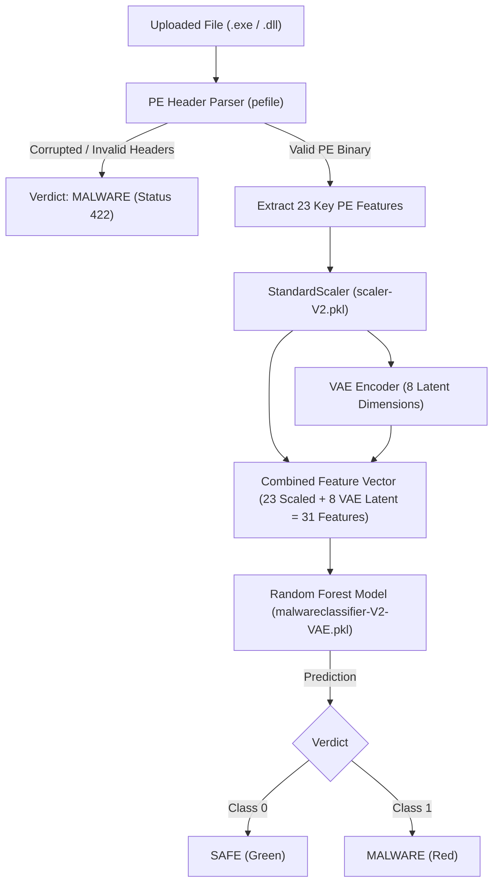

# ⚡ AeroShield - Windows PE Malware Detection Engine

AeroShield is an end-to-end Windows Portable Executable (PE) malware diagnostic system. It leverages deep static inspection, combining an **8-dimensional Variational Autoencoder (VAE)** with a **Random Forest Classifier** to analyze `.exe` and `.dll` binaries for malicious patterns without executing them.

---

## 🌟 Key Features

* **Zero-Execution Static Analysis**: Extracts structural header metadata, entropy figures, and import/export flags safely using `pefile`.
* **Hybrid ML/DL Architecture**:
  * **Variational Autoencoder (VAE)**: Projects 23 core PE header features into an 8-dimensional latent space bottleneck to capture non-linear structural properties.
  * **Random Forest Classifier**: Combines normalized PE header attributes with VAE latent representations for high-confidence verdict classification.
* **Resilient Parsing & Verification**:
  * Handles corrupted binaries and evasive malformed headers gracefully.
  * Instant classification: **SAFE** (Clean / Benign) vs. **MALWARE** (Malicious / Corrupted / Evasive PE).
* **Interactive Web Interface**:
  * Clean drag-and-drop file upload zone.
  * Real-time inspection of top extracted PE header attributes.

---

## 🏗️ System Architecture



---

## 📊 Extracted PE Header Features (23 Features)

The diagnostic engine extracts and analyzes 23 key attributes from the PE Optional Header, File Header, and Section Headers:

| Feature Name | Description |
| :--- | :--- |
| `MajorLinkerVersion` | Toolchain compiler major version |
| `MinorOperatingSystemVersion` | Minimum OS minor version required |
| `MajorSubsystemVersion` | Target Windows subsystem major version |
| `SizeOfStackReserve` | Total reserved stack memory footprint |
| `TimeDateStamp` | POSIX compile timestamp |
| `MajorOperatingSystemVersion` | Minimum OS major version required |
| `Characteristics` | Binary characteristics flag bitmask |
| `ImageBase` | Preferred virtual memory base load address |
| `Subsystem` | Target OS subsystem (GUI, CUI, POSIX, etc.) |
| `MinorImageVersion` | User-defined binary minor version |
| `MinorSubsystemVersion` | Subsystem minor version |
| `SizeOfInitializedData` | Initialized data section size |
| `DllCharacteristics` | DLL flags (ASLR, DEP, SafeSEH support) |
| `DirectoryEntryExport` | Presence flag of Export Directory Table |
| `ImageDirectoryEntryExport` | Byte size of Export Directory |
| `CheckSum` | PE image checksum value |
| `DirectoryEntryImportSize` | Byte size of Import Directory |
| `SectionMaxChar` | Maximum section characteristics bitmask |
| `MajorImageVersion` | User-defined binary major version |
| `AddressOfEntryPoint` | RVA of execution entry point |
| `SectionMinEntropy` | Lowest entropy value across binary sections |
| `SizeOfHeaders` | Total size of MS-DOS stub, PE header, & section headers |
| `SectionMinVirtualsize` | Minimum virtual size across all sections |

---

## 📂 Project Structure

```text
AeroShield/
├── app/
│   ├── index.html              # Responsive Web UI
│   ├── server.py               # HTTP backend & diagnostic pipeline
│   └── static/
│       ├── main.js             # Client upload handler & DOM manipulation
│       └── styles.css          # Brutalist cybersecurity design styling
├── dataset_test.csv            # Test evaluation dataset
├── important_features.pkl      # Pickled list of top ranked features
├── malwareclassifier-V2-VAE.pkl# Trained Random Forest classifier
├── malware_ditaction_DL_II_project.ipynb # Research & model training notebook
├── run_app.bat                 # One-click Windows startup script
├── scaler-V2.pkl               # Fitted StandardScaler
├── selected_features.json      # Ordered feature definitions
├── vae_model.pt                # PyTorch VAE model weights
├── .gitignore                  # Git ignore rules for builds, binaries, & datasets
└── README.md                   # Project documentation
```

---

## 🚀 Getting Started

### Prerequisites

* **Python 3.10+** (tested on Python 3.13)
* Required Python packages:
  ```bash
  pip install numpy torch scikit-learn joblib pefile
  ```

### Running the Application

1. Double click [`run_app.bat`](run_app.bat) or run in terminal:
   ```cmd
   run_app.bat
   ```
   Or start the Python server directly:
   ```bash
   python app/server.py
   ```
2. Open your browser and navigate to:
   ```text
   http://localhost:8000
   ```
3. Drag & drop any `.exe` or `.dll` binary into the upload zone to view the diagnostics.

---

## 🔒 Security Notice

AeroShield performs **static analysis only**; uploaded binary files are inspected purely as raw byte buffers for header analysis and are **never executed**.
